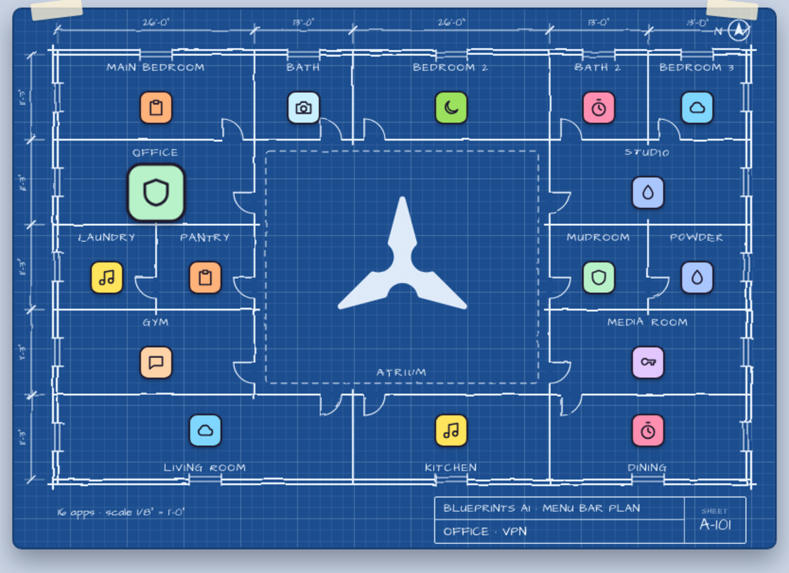
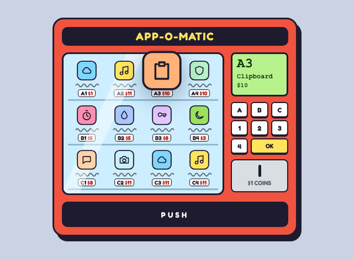
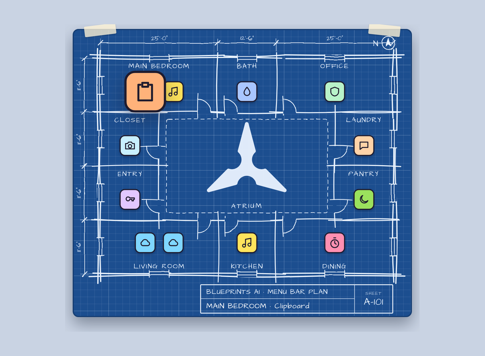
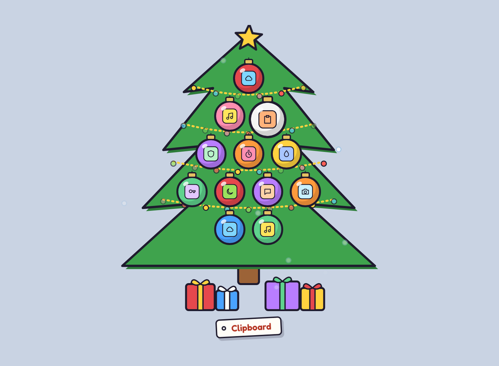
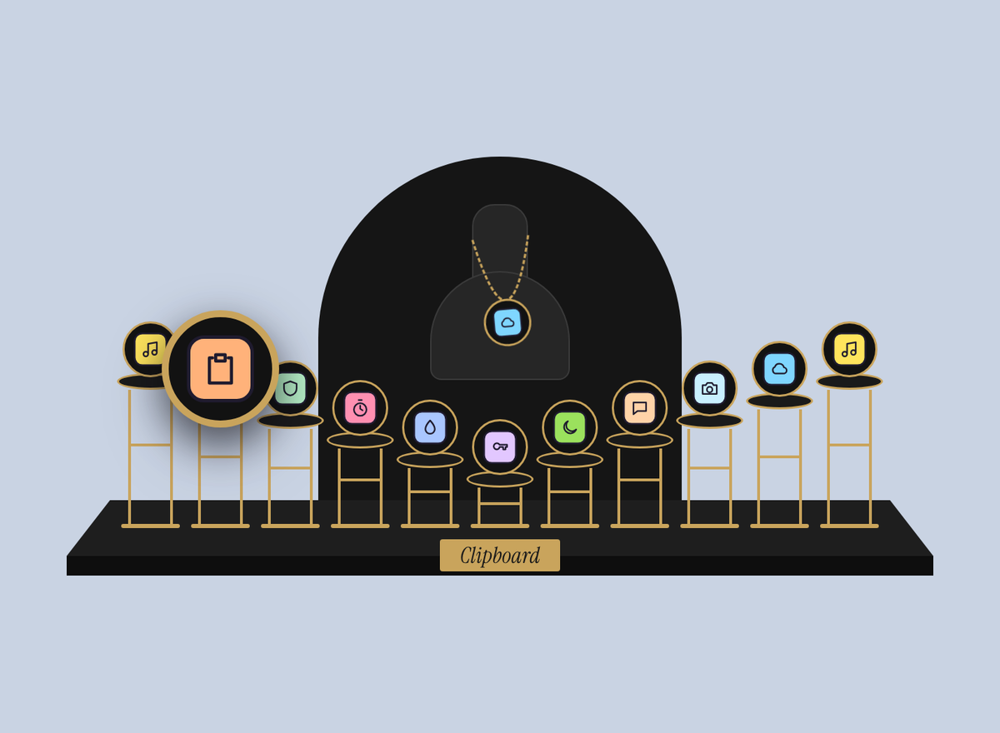
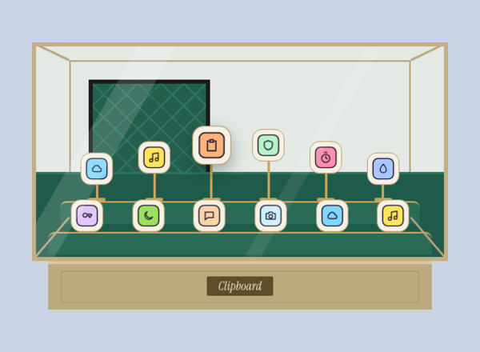
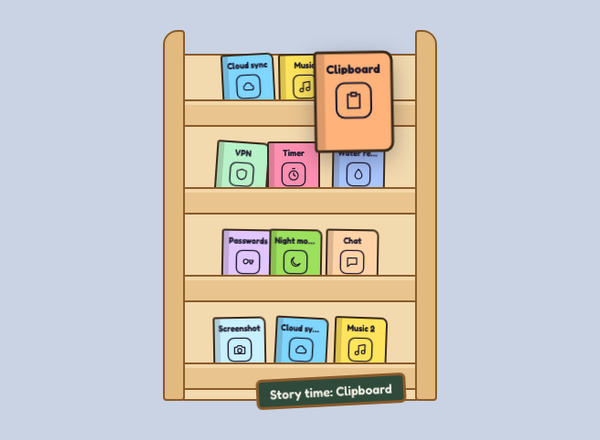
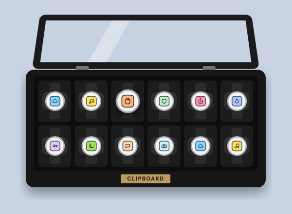
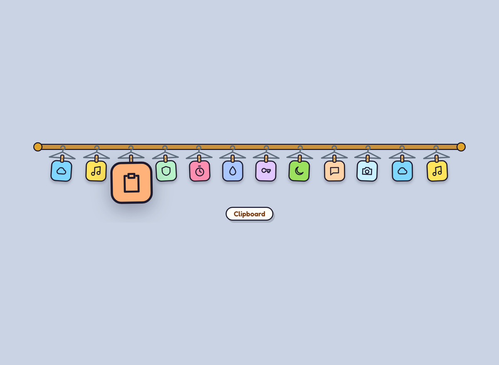

# MenuBuddy

**A goofy menu bar helper for when the menu bar is too full, or the notch eats your icons.**

<!-- site:intro (cocooncao.com/menubuddy copies the marked parts of this README) -->
MenuBuddy is a free, open-source menu bar organizer for Mac, and a playful alternative to Bartender
or Ice. Rest the pointer on its icon and a little scene drops down with every app that has an icon
up there: a vending machine, a velvet jewelry stand, a glass case, a floor plan… Point at an app and
it grows; click it and its own menu opens, even if its icon is hidden behind the MacBook notch.
<!-- /site:intro -->

<!-- site:install -->
## Install

Open **Terminal** (Applications → Utilities → Terminal), paste this line and press Return:

```sh
curl -fsSL https://raw.githubusercontent.com/cocoxcao/MenuBuddy/main/install.sh | bash
```

It downloads the latest MenuBuddy, checks it against its SHA-256 checksum and its code signature,
puts it in Applications and opens it. Run the same line again to update. The script is short:
[read it](https://github.com/cocoxcao/MenuBuddy/blob/main/install.sh) first if you like. MenuBuddy needs macOS 13 or later,
on Apple silicon or Intel. It isn't notarized by Apple yet; a file fetched this way isn't marked as
downloaded, so macOS opens it without the "Not Opened" warning.

To build it from the code on your Mac instead (needs Apple's Command Line Tools), end the line with
`bash -s -- --from-source`.

**Using an AI assistant?** (Claude Code, Cursor, Codex…) Give it this and it does the rest:
*Install MenuBuddy from https://github.com/cocoxcao/MenuBuddy*. The steps it follows are in
[AGENTS.md](https://github.com/cocoxcao/MenuBuddy/blob/main/AGENTS.md).

## Update

Right-click MenuBuddy's icon → **Check for Updates…** (also in Settings, next to the version number): if there's a newer version, click Update and
MenuBuddy installs it and opens again. Or run the install line again; it replaces the app wherever
it is installed and keeps your settings.

```sh
curl -fsSL https://raw.githubusercontent.com/cocoxcao/MenuBuddy/main/install.sh | bash
```

## Delete

```sh
curl -fsSL https://raw.githubusercontent.com/cocoxcao/MenuBuddy/main/install.sh | bash -s -- --uninstall
```

This quits MenuBuddy, deletes the app, forgets its settings and takes it off the Accessibility list.
By hand: right-click its menu bar icon → Quit, then drag MenuBuddy from Applications to the Trash.
<!-- /site:install -->

<!-- site:body -->
## Themes

Pick one in Settings (right-click the MenuBuddy icon → Settings…). Each has a live preview.

### A closer look: Blueprints



Your menu bar as a house plan, drawn in white pencil on blueprint paper. Each app gets a room (bedroom,
office, kitchen…) with walls, doors, windows and dimension lines, and the Blueprints AI mark sits in
the atrium in the middle. Rest the pointer on an app and the title block, bottom right, names its
room and the app, like a real drawing sheet. With many apps, the big rooms take two.

*[Blueprints AI](https://www.blueprints-ai.com/) is AI that generates construction blueprints. Cofounded by Coco.*

### Play the vending machine



Click any app on the shelves to open it, or play the right side like a real machine:

1. **Type a code** on the keypad: the letter, then the number under the app (like A1).
2. **Click the coin** to drop in $1 at a time, until you've paid the price on the screen.
3. **Press OK.** The coil turns, the app falls into the PUSH tray, and you click it there to open it.

Pay too much and the screen gives you change.

### All themes

| Theme | Picture | What it is |
|---|---|---|
| **Vending Machine** |  | Apps on spiral coils, each with a price from $1 to $15. Click an app to open it, or play along: type its code on the keypad, click the coin slot once per $1, press OK, and the app drops into the tray. |
| **Blueprints** |  | A hand-sketched floor plan with the Blueprints AI mark in the atrium; each app gets a room, and big rooms take two when there are many apps. |
| **Christmas Tree** · *[Limited](docs/images/theme-christmas.png "A seasonal theme, select it in Settings. It's a tree to hang your apps on, and it's also hiding a little **surprise**...")* |  | Your apps as ornaments on a tree, with lights, a star and presents. |
| **Velvet Stand** |  | Black velvet and gold pedestals, with one app hanging as a pendant. |
| **Glass Case** |  | An emerald museum case with apps on gold stands. |
| **Book Rack** |  | Apps as picture books on a wooden rack. |
| **Watch Box** |  | Apps as watch faces on cushions under a glass lid. |
| **Clothes Rail** |  | Apps hanging from hangers on a rail, swaying gently. |

## Use

- **Open:** rest the pointer on the MenuBuddy icon (or click it). The top-right corner of the
  screen works too.
- **Pick an app:** click it. MenuBuddy clicks that app's menu bar icon for you.
- **Rearrange:** drag an app onto another one; it takes that spot. The order is saved and every
  theme uses it. Apps MenuBuddy hasn't seen before join at the end.
- **Hide an app:** drag it onto **Drop here to hide** (it appears at the bottom while you drag),
  or right-click it → Hide. Its real menu bar icon is untouched. Unhide in Settings → Your apps
  (the eye button, or Show All), where you can also drag rows to reorder and reset the order.
- **Settings / Quit:** right-click the icon. Settings has the theme switcher with a live preview,
  options for the hover, the corner, showing only icons hidden behind the notch, including
  Apple's own icons, and open at login, and an Insights tab: how often you open MenuBuddy, which
  apps you click most, and your daily average.
- **Move the icon:** ⌘-drag it in the menu bar. Keep it near the clock so the notch can't hide it.

MenuBuddy needs **Accessibility** access (System Settings → Privacy & Security → Accessibility,
not Screen Recording) to read and click other apps' menu bar icons. Right-click its icon → Allow
Accessibility Access… opens the list with a small floating window you can drag MenuBuddy from.<!-- site:omit -->
The permission survives rebuilds: the app is signed against its bundle id, not one build.<!-- /site:omit -->
<!-- /site:body -->

## FAQ

<!-- site:faq -->
**Is MenuBuddy a free alternative to Bartender?** Yes. Like Bartender, Ice or Hidden Bar, it gets
you to every app in your menu bar, and it's free and open source (GPL-3.0). It works differently:
your menu bar stays as it is, and MenuBuddy shows every icon in a drop-down scene that opens when
you rest the pointer on it.

**How do I see menu bar icons hidden behind the MacBook notch?** Install MenuBuddy and rest the
pointer on its icon, or on the top-right corner of the screen. Every app with a menu bar icon shows
up, including the ones the notch covers, and clicking one opens its own menu. In Settings you can
choose to show only the icons the notch hides.

**How do I customize the menu bar on a Mac?** macOS lets you ⌘-drag menu bar icons to move them.
MenuBuddy adds eight themes for the drop-down, drag-to-reorder, and hiding apps you don't need from
its list, without touching their real icons.

**Is MenuBuddy safe? Does it collect data?** It sends nothing anywhere: no analytics, no accounts,
and it only asks GitHub for a newer version when you click Check for Updates…. The code is open, the installer checks the download's checksum, and it uses
Accessibility only to list your menu bar apps and click the one you pick.

**Which Macs does MenuBuddy run on?** macOS 13 Ventura or later, on Apple silicon and Intel Macs.
<!-- /site:faq -->

## Privacy

<!-- site:privacy -->
- **No network:** no analytics, no automatic update checks, nothing sent anywhere. The one exception
  is **Check for Updates…** in the menu or Settings: only when you click it, MenuBuddy asks GitHub for the latest
  version number, and downloads it only if you choose Update. The theme pages are files
  inside the app, and a WebKit content rule list<!-- site:omit --> (`WebGuard.swift`)<!-- /site:omit --> blocks every load that isn't
  a local file or data URL (images, scripts, fonts, fetch, beacons, frames, navigation), so a page
  couldn't reach the internet even if it tried.
- **Accessibility** is used only to list the apps in your menu bar and click the one you pick.
- **Insights** (Settings → Insights) counts how often you open MenuBuddy and click each app. The
  counts stay in MenuBuddy's settings on your Mac; Reset clears them.
<!-- /site:privacy -->

## Build

```sh
scripts/build.sh            # → build/MenuBuddy.app
scripts/build.sh --install  # → ~/Applications/MenuBuddy.app, and launch it
scripts/build.sh --release  # → build/MenuBuddy.zip: universal, hardened runtime, no dev tools
```

Development builds include the tools below (`MENUBUDDY_THEMES`, `--snapshot`, `--seasonal-test`);
release builds compile them out (`-D DEV_BUILD` is only set for development).

Needs only the Command Line Tools (same swiftc + overlay workaround as FileWheel). macOS 13+.

The Christmas Tree theme's seasonal extra is kept encoded in `Resources/Themes/seasonal.dat`;
`scripts/seasonal.sh decode` writes it out as `build/seasonal.html` to edit, and
`scripts/seasonal.sh encode` stores it again.

Releases: commit, then `scripts/release.sh 0.2.0 "What changed"`. It sets the version, builds the
universal zip and its checksum (`scripts/build.sh --release`), tags, pushes and creates the GitHub
release; `install.sh` always takes the latest one, so users update with the install line.

## Making themes

Each theme is a web page in `Resources/Themes/<id>.html` shown in a transparent panel, listed in
`themes.json` (`"limited": true` adds the tag in Settings), with a 22×22 menu bar glyph in
`icons/<id>.svg` (dark outlines in `#1F1B2E` turn light on a dark menu bar). The contract is at the
top of `buddy.js`: apps come from `h.app(…)`, buttons that aren't apps use `data-action` and the
theme's `action()`. `cloth.html` is the simplest example. Fonts (Fredoka, DM Sans, Instrument Serif,
Architects Daughter, all OFL) ship in `fonts/`.

Check a theme quickly:

```sh
scripts/shoot.sh vending "hot=2"        # headless Chrome, sample apps → build/shots/
build/MenuBuddy.app/Contents/MacOS/MenuBuddy --snapshot vending out.png --hot 2   # WebKit, your running apps' icons
MENUBUDDY_THEMES=$PWD/Resources/Themes build/MenuBuddy.app/Contents/MacOS/MenuBuddy   # edit themes without rebuilding
```

Designs: the canvas "Menu Bar Buddy looks" on claude.ai.

## License

MenuBuddy is free software, released under the GNU General Public License v3.0: see
[LICENSE](LICENSE). Copyright © 2026 Coco Cao.

- The fonts in `Resources/Themes/fonts` are under the SIL Open Font License 1.1
  ([OFL.txt](Resources/Themes/fonts/OFL.txt)).
- The Blueprints AI name and mark (`Resources/Themes/blueprints-mark.svg`) belong to Blueprints AI
  and are not covered by the GPL. If you share a changed version, leave the mark out or ask first.
